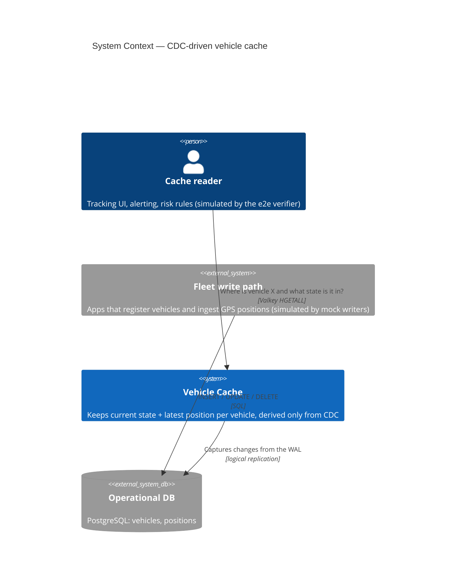
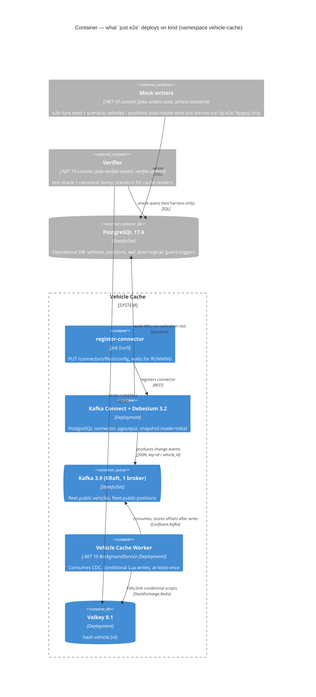
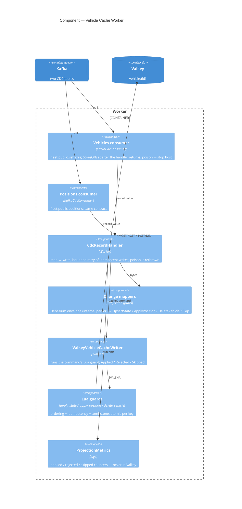
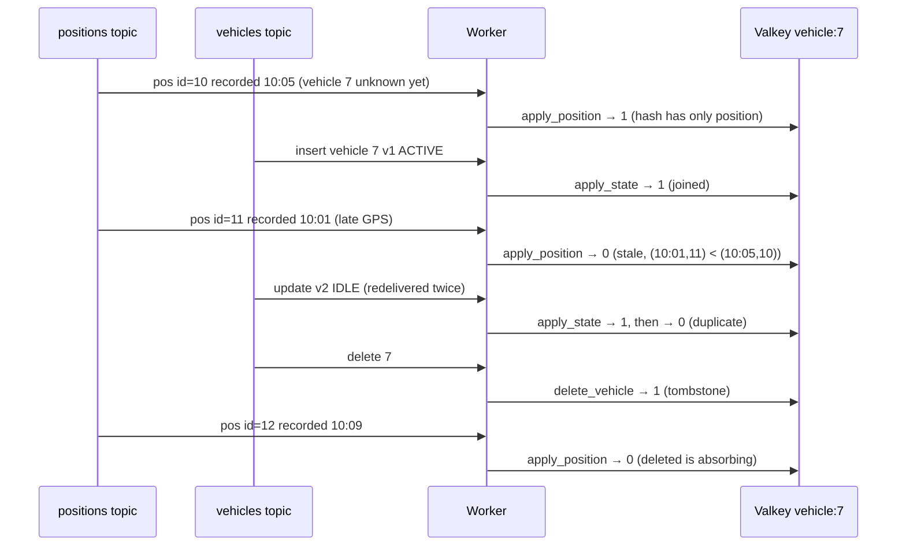

# 01 — C4 Model

Status: **Final** — checked against `k8s/`, `devspace.yaml` and `justfile` (rule: diagrams show exactly what `just e2e` runs; anything else is labelled).

## Level 1 — System Context

## Level 2 — Container

> There is intentionally **no edge from the Worker to PostgreSQL**. The only reader of Postgres besides Debezium is the verifier, which is the test oracle.

## Level 3 — Component (Worker)

## Runtime view — the hard cases (sequence)

